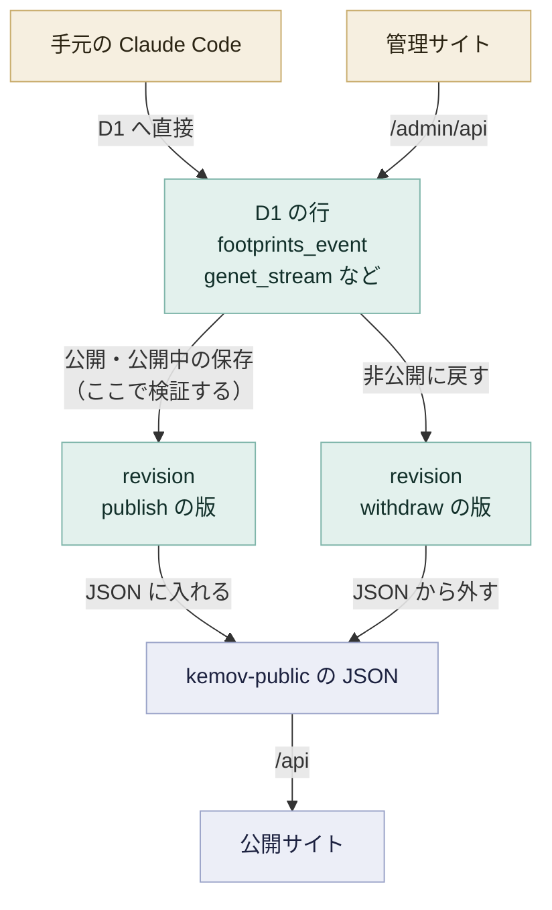

# 管理サイト

`/admin` は、人手で作るデータを直して公開するための管理サイトです（#141）。`/admin/api` がその API で、Cloudflare Access の後ろにあります。画面は `src/admin/`、API は `worker/src/admin/` にあります。

## 設計の方針

#141 で、次の 4 つを決めました。

- 読みと書きの経路を分ける
  - 読むのは `/api` で、公開され、キャッシュされる
  - 書くのは `/admin/api` で、Access の後ろにある
- 公開の状態を行に持つ
  - あしあとの `footprints_event`、ジェネット楽曲一覧の `genet_stream`、登録者数の節目の `subscriber_milestone` は、`status` の列を持つ
- 版の履歴は追記だけにする
  - `revision` と `publication` は、トリガーが `UPDATE` と `DELETE` を拒む
- 公開の条件は、公開するときに確かめる
  - 下書きのあいだは、条件を満たしていなくてよい

書き込みの入口は 2 つあります。手元の Claude Code は D1 へ直接書き、管理サイトは `/admin/api` を通ります。どちらから書いた行も、公開という 1 つの門を通らなければ公開サイトに出ません。そのため公開の条件はその門で確かめれば足り、Claude Code の側で守ることはありません。

3 つのデータとも、版を記録する要求の中で JSON を書き直します。「公開」「公開中の保存」「非公開に戻す」の 1 回で本番に出ます（#281、#283、#284）。

JSON を書き直せなかったときは、各一覧の上に「本番に反映」を出し、記録から JSON を作り直せるようにします（#285）。

公開の門を通るのは、あしあと・ジェネット楽曲一覧・登録者数の節目だけです。メンバー・動画の上書き・統計の除外は、保存した時点で効きます。出典のホワイトリストは公開の門の設定で、保存した時点で効きます。

## `/admin` と Cloudflare Access

`/admin/*` はサイトの書き込みの側です（#141）。`/admin/api/*` はその API で、worker が直接答え、背後にビルドしたファイルはありません。

それ以外の `/admin/*` のパスには、管理サイトそのもの（`src/admin/`、#144）を返します。ビルドしたページは `dist/admin/index.html` の 1 つだけで、パスが何であっても `ASSETS` からそれを返します。返すのは `worker/src/admin/index.ts` の `servePage` です。「1 つのファイルがこの下のすべてのパスに答える」という形は、`worker/src/pages/index.ts` が `/members/<id>` と `/videos/<id>` で使っているものと同じです。その 1 つのページがどの画面を出すかは、ブラウザの側で `src/admin/router.ts` が決め、worker は関わりません。

Cloudflare Access が `/admin` 全体の前に立ち、許可した人以外を実際に締め出します。Access の承認が無い要求は、worker に届きません。

worker も、`/admin/api/*` への要求をすべて `worker/src/lib/access.ts` で確かめます。Access の公開鍵を `https://${ACCESS_TEAM_DOMAIN}/cdn-cgi/access/certs` から取り、`Cf-Access-Jwt-Assertion` ヘッダーの署名・`iss`・`aud`・`exp`/`nbf` を、Access のエッジと同じように検証します。通らなければ要求を拒みます。

署名が通ったあとは、トークンが名指すメールアドレスが `ADMIN_EMAILS` にあるかも確かめます。無ければ、署名が通らなかったときと同じ 401 を返します。`/admin/api/me` も同じです。

これは Access の代わりではありません。誰がサインインできるかを決めるのは、あくまで `/admin` の前にある Access のポリシーです。worker の検証が防ぐのは、次の 2 つの誤りです。

- Access のアプリケーションが消えたり、パスが外れたりして、ポリシーが `/admin/api` の前に立たなくなる
  - 署名を確かめるので、Access を通っていない要求は素通りしない
- ポリシーを広げすぎて、管理者でない人まで Access を通れるようになる
  - Access は、その人にも正しく署名したトークンを出す。メールアドレスの照合が、それを止める

防げないのは、`ADMIN_EMAILS` に載っているアドレスの持ち主になりすます誤りです。Access が確かめたメールアドレスを、worker はそのまま信じます。

以前の版は、署名を確かめずに `aud` だけを比べていました。#144 のレビューで、書き込みの経路には足りないとされ、署名を検証する形にしました（2026-09-18）。

書き込み（GET・HEAD 以外）は、同じオリジンの管理画面から来た要求だけを通します。`Sec-Fetch-Site` が `same-origin` のとき、またはこのヘッダーが無く `Origin` が要求先のオリジンと一致するときです。どちらも満たさなければ 403 を返します。この検査は Access の検証と管理者の照合の直後、どのルートの照合よりも前に 1 か所で行うので、新しい書き込みのルートも自動で対象になります。本文を読むルートは、`Content-Type` が `application/json` でなければ 415、本文が 1 MiB を超えれば 413 を返します。

`ACCESS_AUD` は、`/admin` の前にある Access のアプリケーションの `aud` タグです。`ACCESS_TEAM_DOMAIN` は Access のチームのドメイン（`<team>.cloudflareaccess.com` の形）で、シークレットではなく `wrangler.toml` の `[vars]` に置きます。Access のログイン画面でブラウザが既に向かうドメインと同じだからです。`ACCESS_AUD` か `ACCESS_TEAM_DOMAIN` のどちらかが無いとき、または鍵を取れないときは、Access のポリシーにかかわらず `/admin/api/*` への要求をすべて拒みます。

`ADMIN_EMAILS` は、`/admin/api` を使ってよい管理者のメールアドレスを、カンマで区切って並べたシークレットです。リポジトリが公開で、人の名前を含むので、`[vars]` には置きません。アドレスの区切りはカンマで、空白や改行も区切りとして読みます。空の要素は無視します。比べるときは、ASCII の大文字と小文字を区別しません。登録されていないとき、または空のときは、`ACCESS_AUD` が無いときと同じく、要求をすべて拒みます。Access のポリシーに管理者を足したら、ここにも足します。登録の手順は[デプロイ](../guides/deployment.md)にあります。

## エンドポイント

`/admin/api` のエンドポイント、公開の条件、出典のホワイトリストの判定は [管理サイトの API](api/admin.md) にあります。

## 画面

`src/admin/` は管理サイトのフロントエンドです（#141、#144）。素の Vue と素の HTML・CSS で書き、Vuetify を使いません。公開サイトの部品群から管理サイトを切り離すという #127 の決定を、ここにも当てはめています。

公開サイトと共有するのは、`src/shell/tokens.css` の色の変数だけです。公開サイトの外枠（`SiteNav.vue` など）とダークの配色は共有しません。#141 のデザインで管理サイトはライトだけと決まったので、`src/admin/index.html` は `<html data-theme="light">` に固定しています。これで、閲覧者の OS の設定にかかわらず、`tokens.css` の色はすべてライトの側になります。

`src/admin/router.ts` は、`#` のフラグメントではなく、クライアント側のルーター（`vue-router` の history モード）です。再読み込みや共有したリンクでも、同じ画面に戻れます。worker はどの `/admin/*` のパスにも同じページを返し（[`/admin` と Cloudflare Access](#admin-と-cloudflare-access)）、画面を選ぶのはブラウザに任せます。

`src/admin/AdminShell.vue` は、すべての画面を囲む外枠です。上端のバーには、群・ページ・開いている項目の名前を並べたパンくずと、アカウントのメニューを出します。メニューにあるのは「公開サイトを開く」と「ログアウト」だけで、アカウントの名前やメールアドレスは出しません。ログアウトは Cloudflare Access の `/cdn-cgi/access/logout` へのリンクで、worker は関わりません。

サイドバーには 3 つの群を、次の順に並べます（#277 の論点 4）。サイドバーは « で細く畳め、» で開きます。畳んだかどうかはブラウザに覚えます。

- やること: 収集の失敗
- データ: 統計・登録者数の節目・あしあと・メンバー・配信・動画・ジェネット楽曲一覧
- 運用: 版の履歴・出典ホワイトリスト

項目の横には、次のものを出します（`src/admin/lib/sidebar.ts` の `badgeFor`）。

- 収集の失敗は、`GET /admin/api/collect-tasks` の `count` を注意の色の丸で出す
- 登録者数の節目・あしあと・ジェネット楽曲一覧は、`GET /admin/api/drafts` が返す下書きの行の数を、収集の失敗と同じ注意の色の丸で出す
  - 本番の JSON が記録に追いついたか確かめていないときは、数の横に ⚠ の印を出す。読み上げと、マウスを載せたときの表示は「本番に未反映の変更あり」。条件は一覧の上の「本番に反映」と同じ
  - 読めなかったデータには、数も印も出さない
  - 行の作成・保存・公開・非公開に戻す・削除と、まとめて公開の後に読み直す（`src/admin/lib/sidebar-drafts.ts` の `refreshSidebarDrafts`）
- それ以外の項目は、名前だけを出す
- サイドバーのどの項目にも当たらないパスには、`src/admin/pages/PlaceholderPage.vue` を出す

各画面の見出しの横には「ヘルプ」を置き、[管理サイトの使い方](../guides/admin.md) のその画面の節へリンクします（`src/admin/lib/help.ts`）。画面には説明の文を常には出さず、ヘルプに書きます（#300）。

どの画面も、表（`.pane`）を上に、開いた項目の編集の欄（`.inspector`）を下に置きます。間の仕切り（`src/admin/components/SplitHandle.vue`）は、ドラッグと上下の矢印キーで動かし、ダブルクリックで元の高さに戻します。仕切りの位置は、画面ごとにブラウザに覚えます。編集の欄の項目は、幅に応じて最大 3 列に並べます。

編集の欄の「プレビュー」を押すと、欄の右に、公開ページでの見え方を出します（`src/admin/components/PreviewPane.vue`）。開いたかどうかは、すべての画面で 1 つの値としてブラウザに覚えます。中身は画面ごとに次のとおりです。

| 画面               | プレビューの中身                                                                                                                                                     |
| ------------------ | -------------------------------------------------------------------------------------------------------------------------------------------------------------------- |
| あしあと           | 年表のカード（公開サイトの `EventCard.vue`）と、それが載る日                                                                                                         |
| 登録者数の節目     | グラフの点を押したときのカード（`MilestoneCard.vue`）と、そのメンバーのふしめのグラフ（`MilestoneTrail.vue`）。グラフは公開中の節目に、編集中の 1 件を差し込んで描く |
| メンバー           | 顔・名前・活動期間を、公開サイトの部品で寄せ集めた見本                                                                                                               |
| 配信・動画         | サムネイル・メンバー・タイトル・種類の見本                                                                                                                           |
| ジェネット楽曲一覧 | 開いている曲の「楽曲」の欄（公開サイトの `SongDetail.vue`）。演奏した回数は、公開中の配信に、編集中の配信を差し込んで数える                                          |

- あしあと・節目・ジェネット楽曲一覧は、編集中の値を公開の JSON の形に直し、公開サイトと同じ読み手（`readFootprintEvents`、`readSubscriberMilestones`、`readGenetMusicData`）に通してから描きます（`src/admin/lib/preview-public.ts`）。公開ページで読めない値は、どの欄かを示して止めます
- 公開サイトの API（`/api/channels` など）は、管理サイトと同じオリジンにあり、Cloudflare Access がかかっていません。プレビューはそれを読みます（`src/admin/lib/public-data.ts`）
- プレビューはライトだけで描きます。書体は公開サイトと同じ Murecho です
- プレビューの下には注記を出しません。保存がいつ公開ページに出るか、上書きや除外した tick が公開ページのどこに効くかは、[管理サイトの使い方](../guides/admin.md) に書きます（#300）

あしあと・登録者数の節目・ジェネット楽曲一覧の編集の欄は、次の動きをそろえています（#280）。部品は `src/admin/lib/editing.ts`・`src/admin/lib/unsaved-guard.ts`・`src/admin/components/DeleteButton.vue` にあります。

- 保存していない変更があると、見出しに「未保存」と出す
  - 見た目は、メンバーの画面の「未保存」と同じ `chip waiting`
  - 楽曲一覧では配信と曲を別々に保存するので、開いた曲の見出しにも出す
  - 変更があるかは、欄の値を保存した行と比べて決める。空の欄と、書いて消した欄は同じとみなす
- 変更があるまま別の行を選ぶ・「← 一覧」を押す・絞り込みを変える・別の画面へ移るときは、変更を破棄するか確かめる
  - 破棄すると、欄は保存した値に戻る
  - 絞り込みでも確かめるのは、開いている行が一覧から外れると、編集の欄も閉じるため
  - 一覧を読み直す操作でも確かめる。読み込みに失敗したときの「再読み込み」と、「まとめて公開」が当たる。読み直すと、行が一覧から外れて欄が閉じることがあるため
  - 楽曲一覧の「公開」「保存」「非公開に戻す」と、新しい配信の「保存」では、配信が状態かタイトルの絞り込みから外れるときだけ、開いた曲の変更を破棄するか確かめる。配信の欄は送って保存するので確かめない
  - 「まとめて公開」では、確認の窓に答えてから変更のことを聞く。まとめて公開するのをやめれば、変更は残る
  - 楽曲一覧で、変更のある曲を「この配信から除外」で外すときも確かめる
  - 楽曲一覧で、読み直した演奏の並びが変わっていたとき（保存の合間に別の画面で並びを保存したとき）は、曲の書きかけをその曲の行へ移す。並びから外れた曲に書きかけがあれば確かめ、やめると欄をそのまま残す
    - やめたときは、欄が立っている前の版を送る。次の「保存」は 409 で断られ、読み直した配信の欄を黙って戻さない（#307）
    - 次に読み直したときも、前の版の欄を基準に合わせ、外れた曲があればもう一度確かめる
  - 楽曲一覧で保存などが断られた後は、別の画面の変更で配信が絞り込みから外れても、一覧に残して編集の欄を開いたままにする。通った後は今までどおり閉じる
  - 楽曲一覧で、送信中に変更を破棄したときは、遅れて届いた答えで破棄した欄を戻さない
  - タブを閉じるときと再読み込みでは、ブラウザの確認だけを出す
- 開いている行を読み直しても、打った欄は消さない（#304）。部品は `src/admin/lib/editing.ts` の `fieldsOnReload`
  - 打っていない欄は、読み直した値にする。もう一度「保存」を押したときに、別の画面で保存した変更を戻さないため
  - 打った欄を別の画面も変えていたときは、その欄を赤枠で示す
  - 保存が別の画面の変更で断られたとき（409）と、何も保存しなかった 502 のときに効く。読み直した後にもう一度「保存」を押すと、打った内容で上書きする
  - 送った欄が保存された要求の後は、読み直した値を使う。保存が通ったとき、公開で断られた下書き、本番に出せなかった保存が当たる。worker が整えた値を正とするため（`src/admin/lib/publishing.ts` の `sentFieldsSaved`）
    - 送った後に打った欄は残す。別の画面もその欄を変えていれば赤枠で示す（`src/admin/lib/editing.ts` の `fieldsAfterSave`）
    - 保存の後の読み直しに失敗しても、次に読み直したときに同じ扱いにする。間に何も保存しなかった要求（断られた保存など）があっても同じ
  - あしあとでは、メンバーから外した人を主役に残さない。主役はメンバーの中からだけ選ぶ決まりのため
- 「保存」「公開」「非公開に戻す」「削除」は、読んだ行の `version` を添えて送る（#307、#309）。部品は `src/admin/lib/editing.ts` の `writeBody`
  - 削除は本文を持たないので、`version` をクエリで送る（`removePath`）
  - 読んだ後に別の画面がその行を保存していれば、下書きでも公開中でも 409 で断られる。断られた後は上の読み直しが効く
  - あしあと・登録者数の節目・楽曲一覧の配信と曲が当たる（曲は #303）
  - 楽曲一覧の曲の保存が断られたときは、その曲を読み直す。打った欄を残し、両方が変えた欄を赤枠で示すのは配信と同じ
  - worker の側の決まりは[管理 API](api/admin.md#あしあと)にある
- 削除は 2 段にする。「削除」を押すと「削除を確定」と「キャンセル」に替わる
  - 楽曲一覧では配信を削除できる。曲の削除は無い
  - 削除に失敗したときは、メッセージ欄の見出しを「削除できません」にする
- 保存のトーストは、下書きの行なら「下書きを保存しました」
  - 公開中の行は「保存して本番に反映しました」。保存がそのまま本番に出るため
  - 楽曲一覧の曲は、公開中の配信が演奏していれば「保存しました。本番に出ています」、いなければ「保存しました」
- 一覧の件数は「12 件」の形で出し、絞り込み中は「12 / 40 件」にする
  - 絞り込みは worker が行うので、絞り込み中だけ、絞らない一覧をもう 1 回読んで数える（`src/admin/lib/list-total.ts`）

3 つの一覧には、次の 2 つもそろえています（#285）。

- 本番に反映（`src/admin/components/RepublishBand.vue`、`src/admin/lib/republish.ts`）
  - 本番の JSON を記録から作り直す操作です。デプロイの後や、JSON を書き直せなかった後に使います
  - 一覧の上のメッセージ欄に、worker が JSON を作り直す場合にだけ出します。条件は、データごとの `GET .../pending` の答えで決めます
    - あしあと: 公開待ちの版・`behind`・`outdated` のどれかがある
    - 登録者数の節目: 公開待ちの版・`eventChanged`・古い形の JSON・`behind` のどれかがある
    - ジェネット楽曲一覧: 公開待ちの版・古い形の JSON・`behind` のどれかがある
  - メッセージは 3 データ共通で「本番に反映されていない変更があります」です。古い形の JSON だけのときは「本番のデータを新しい形式に更新できます」にします
  - 押した後のトーストは「本番に反映しました」、作り直すものが無ければ「反映する変更はありません」です。502 のときは「本番への反映に失敗しました」、届かなかったときは「サーバーに接続できませんでした」と出します。worker の英語の文は出しません
  - 通ったら、メッセージ欄を次に `GET .../pending` を読むまで消します。ほかの要求の途中の書き込みは、しばらく `behind` に残るためです（`worker/src/admin/publishing.ts` の `ABANDONED_WRITE_MINUTES`）。次に読んだときにまだ残っていれば、また出します
  - `behind` は `publication_write` に残った行で決まります（[あしあと](api/admin.md#あしあと)）
- まとめて公開（`src/admin/components/BulkPublishBar.vue`、`src/admin/components/BulkPublishOutcome.vue`、`src/admin/lib/bulk-publish.ts`）
  - 表の左端の選択の列で、下書きの行を選びます。公開中の行は選べません。見出しのチェックボックスは、表に出ている下書きをすべて選びます
  - 1 行以上選ぶと、表の下の欄に「N 件を選択中」と［まとめて公開］［選択を解除］が出ます。押すと確認の窓（「N 件を公開しますか」［公開］［キャンセル］）を出します
    - 確認の窓は、開くと［キャンセル］にフォーカスを置きます。Tab は窓の 2 つのボタンの間で回り、Esc で閉じます。閉じると、フォーカスは［まとめて公開］へ戻ります。［公開］で閉じたときは、ボタンに替わって出る進み具合へ移り、終わると結果の欄へ移ります
  - 選んだ行を 1 行ずつ「公開」に通します（#237 と同じ作り）
    - 各行は、公開の直前に読み直した保存済みの欄で公開します。表は、保存の答えが別の行を開いた後に届いたときなどに、行より古いことがあるためです
    - 読み直した時点でもう公開中だった行には、何も送りません。その行は「公開」に数えず、「公開済み」に数えます。ほかの要求が公開を記録した後に、本番の JSON を書けなかったかもしれないためです
    - 公開の条件を満たさずに断られた行は飛ばします。それ以外の失敗では、そこで止めます
  - 終わると、表の下の欄に結果を出します。表は押し下げません
    - 見出しは「N 件中 M 件を公開しました」、内訳は「公開 M 件」「失敗 K 件」「公開済み J 件」です
    - 失敗には、断られた行と、止まった行を数えます。止まった行より後の行は「未処理 N 件」として足します。止まらなかったときは出しません
    - 「公開できなかった行」として、失敗した行と理由を並べます
    - 公開できなかった行と、試さなかった行は、選んだまま残ります
  - 走っている間は、絞り込みと行の選び直しを止めます。楽曲一覧では、配信の欄の下のボタンも止めます
  - 画面を離れると、残りの行は送りません。行を読み直している途中で離れたときも、その行の公開は送りません

狭い幅では、サイドバーを引き出しにし（860px 以下）、表と編集の欄を 1 つずつ出します（600px 以下）。`@media` ではなく `@container` を使う理由は、`src/admin/shell.css` のコメントにあります。

外枠のほかに、次の画面に触れておきます。

- あしあと（`src/admin/pages/FootprintsPage.vue`、`src/admin/components/FootprintsInspector.vue`）
  - 行の状態は「下書き」と「公開中」の 2 つです（#277、#281）。「公開待ち」は、あしあとにはもうありません
  - 表は状態（すべて・下書き・公開中）とタイトルの部分文字列で絞ります
  - 保存・公開・非公開に戻した行は、絞り込みに合わなくなっても、ほかの行を選ぶか絞り込みを変えるまで表の同じ位置に残し、編集の欄も開いたままにします（#282）
  - 編集の欄の下のボタンは、状態で替わります（`src/admin/lib/publishing.ts` の `publishFootFor`）
    - 下書き: 「公開」（主）・「保存」・「削除」
    - 公開中: 「保存」（主）・「非公開に戻す」。「削除」は押せず、横に「公開中は削除できません」と出します
  - 「公開」「公開中の保存」「非公開に戻す」は、どれも 1 回の要求で本番の JSON まで書き直します。通ったことは、トーストと状態の表示で伝えます
  - 断られたときは、欄の上のメッセージ欄に worker が返した理由を箇条書きにし、該当する欄に赤い枠を付けます。worker の検証を画面に写すことはしません（`src/admin/lib/publishing.ts` の `publishAnswerFor`）
    - 下書きの公開: 「公開できません」と理由の下に「下書きとして保存しました」
    - 公開中の保存: 「保存できません」と理由の下に「本番は変更前の内容のままです」
    - 保存は通ったが本番の JSON を書けなかったとき: 「保存しましたが本番への反映に失敗しました」。もう一度「公開」（公開中なら「保存」）を押すと書き直せることは、[管理サイトの使い方](../guides/admin.md#本番に反映されていないとき) に書きます。worker が返した行の状態で、どちらの操作の後かを見分けます
    - 非公開に戻した後に JSON を最新にできなかったとき: 見出しを「本番への反映に失敗しました」にします
    - 非公開に戻せなかったとき: 「非公開に戻せません」と「行は公開中のままです」
  - 公開中の行が本番の JSON と食い違っているとき（JSON を書けなかった保存の後など）は、メッセージ欄に「本番に反映されていない変更があります」と出します
  - 「＋ 追加」は、その場で行を作りません。空の欄を開き、「保存」を押したときに作ります。ボタンは「保存」と「キャンセル」だけです
  - 下書きの保存の 400 は、「保存できません」のメッセージ欄に worker のメッセージをそのまま出します。`src/admin/lib/footprints.ts` の `fieldForSaveError` が、メッセージからどの欄の話かを読みます
  - 「主役」の欄で、関連メンバーのうち出来事の主役を選ぶ。関連メンバーが無いときは「関連メンバーが選択されていません」、デビューで主役が無いときは「デビューには主役が必要です」と出す
  - 出典が足りるかは、画面が入力に合わせて判定します（#277 の 2a・2b、#282）。判定は worker と同じ `src/admin/lib/source-check.ts` で、ホワイトリストは `GET /admin/api/source-whitelist` から読みます
    - 編集の欄の出典の枠: 出典ごとに、URL とタイトルの欄の下へ「ホワイトリスト」かホスト名を出します。同じホストの 2 つ目には「（同じサイト）」を添えます
    - 足りるときは「出典の条件を満たしています」と出します。足りないときは枠を注意の色にし、見出しを「出典不足」にして、「ホワイトリストの出典か別のサイトの出典が必要です」と出します。足りないまま公開すると年表に「出典の確認待ち」と出ることは、[管理サイトの使い方](../guides/admin.md#出典の条件) に書きます
    - 足りなくても、公開と保存は止めません
    - 表: 出典の列に「出典不足」と出します。ツールバーの「出典不足のみ」で、出典が足りない行に絞ります。横の数は、状態とタイトルで絞ったうちの出典が足りない行の数です
    - ホワイトリストを読めないときは、出典の判定を出さず、「出典不足のみ」は押せません。出典の枠には「出典ホワイトリストの読み込みに失敗しました」と出します
- 登録者数の節目（`src/admin/pages/SubscribersPage.vue`、`src/admin/components/SubscriberMilestoneInspector.vue`、#225）
  - 行の状態は、あしあとと同じく「下書き」と「公開中」の 2 つです（#277、#283）。表はメンバーと状態（すべて・下書き・公開中）で絞り、達成日の古い順に並べます
  - 編集の欄の下のボタン、トースト、断られたときのメッセージ欄は、あしあとと同じです（`src/admin/lib/publishing.ts`）。「公開」「公開中の保存」「非公開に戻す」は、どれも 1 回の要求で本番の JSON まで書き直します
    - 違うのは 1 つだけです。公開中の保存がほかの操作とぶつかり、本番の JSON を元に戻せなかったとき（502 で `saved` が `false`）は、「保存できません」のメッセージ欄に worker のメッセージではなく「本番の登録者数の節目への反映に失敗しました」を出します
  - 出典の枠では、出典ごとの扱いを URL の横に出し、足りるかどうかを枠の中に出します（#277 の 2a）。判定は worker の `POST /admin/api/subscribers/source-check` に任せ、出典・メンバー・公表者を変えるたびに少し待ってから問い合わせます
    - 横に出すのは「ホワイトリスト」「本人の動画」、そのどちらでもなければホスト名です。同じホストの 2 つ目は「ホスト名（同じサイト）」です
    - 足りるとき: 「出典の条件を満たしています」
    - 足りないとき: 枠を注意の色にし、見出しを「出典不足」にして、「ホワイトリストの出典か別のサイトの出典が必要です」と出します。あしあとと違い、足りないと公開できません（#277 の 6-7）
    - 問い合わせに失敗したときは、どちらとも言いません
  - 「＋ 追加」は、その場で行を作りません。空の欄を開き、「保存」を押したときに作ります。日付と登録者数を空のまま作れないうえ、仮の値を入れると、公表された数のように残るおそれがあるためです。あしあとも同じ形です
  - 関連する出来事は、あしあとの `kind = 'milestone'` の出来事から選びます
  - 日付と登録者数は、人が公表を見て入力します。YouTube API の値を候補として出しません（#222）
  - リスナーの投稿の URL は、この画面にだけ出ます。公開の JSON には worker が入れません
- ジェネット楽曲一覧（`src/admin/pages/SetsPage.vue`）
  - `.pane`/`.inspector` の代わりに `.setlist`/`.editor` を使う。配信のデータは、項目を格子に並べる編集の欄ではなく、曲ごとの区切りで編集するため。上下の並べ方と仕切りは `.pane`/`.inspector` と同じ
  - 配信の状態は、あしあとと同じく「下書き」と「公開中」の 2 つです（#277、#284）。「公開待ち」と「あとで」は、楽曲一覧にもうありません
  - 配信の一覧は、状態（すべて・下書き・公開中）とタイトルの部分文字列で絞ります。読み込めないときは、一覧に「再読み込み」を出します
  - 配信の欄の下のボタン、トースト、断られたときのメッセージ欄は、あしあとと同じです（`src/admin/lib/publishing.ts`）。「公開」「公開中の保存」「非公開に戻す」は、どれも 1 回の要求で本番の JSON まで書き直します
    - 「公開」と「非公開に戻す」も、入力中の配信の欄を送って保存してから進めます（#277 の 6-2）
    - 断られたときは、メッセージ欄に worker が返した理由を並べ、タイトル・動画 ID・何曲目かの演奏に赤い枠を付けます
  - 「＋ 追加」は、その場で行を作りません。空の欄を開き、「保存」を押したときに作ります。あしあと・節目と同じ形です
  - 曲は、それを演奏するすべての配信で共有する。そのため、曲のクレジットの保存（「この曲を保存」）は、配信の欄と演奏する曲・シーンの保存とは別の操作
    - 公開中の配信が演奏している曲は、保存がそのまま本番に出ます（#277 の 6-5）
    - 公開の条件を満たさないときは、開いた曲の上のメッセージ欄に「曲を保存できません」と理由を出し、「本番は変更前の内容のままです」と添えます。何も保存しません
    - 保存は通ったが本番の JSON を書けなかったときは、メッセージ欄に「保存しましたが本番への反映に失敗しました」と出します
  - 曲を読み込んでいる間に、その曲より上の曲を配信から外しても、開いている曲は開いたまま読み直します
  - Markdown の欄（曲の題、演奏の説明）は、書く欄の真下にその場のプレビューを出す。描き方は公開ページと同じ（`src/lib/genet/musicSong.ts` の `markdownHtml`）。原題は、公開ページと同じく Markdown として読まずにそのまま出す
  - Markdown の欄には、決まった形の Markdown のリンクをカーソルの位置に挿入するボタンがある。リンクの種類は Wikipedia・英語版 Wikipedia・配信のタイムスタンプ・URL そのもの
- メンバー（`src/admin/pages/MembersPage.vue`）
  - 名前・色・活動期間を直す。PUT で置き換えられるのは、`channel_id`・表示順・収集が書く 3 列を除いた列（#158）
  - 「＋ メンバーを追加」で、新しいメンバーを一覧の末尾に足します。表示順は各行の「↑」「↓」で動かします（#211）
  - 足した行と動かした順番は、「保存」を押すまで画面の中だけにあり、一覧の上の見出しに「未保存」と表示します。「保存」を押すと、足した行と全員の表示順を 1 回の batch で書きます。途中の並びは公開されません
  - 編集の欄には、あしあと・節目と同じ部品で、保存していない入力があるときに「未保存」と出し、離れる前に確かめます（#286）
    - 保存していない入力
      - 保存済みのメンバーの欄が、保存した値と違うとき
      - 「新しいメンバー」の欄に、何か書いてあるとき
      - 足した行の欄は数えない。値が一覧の下書きに入っていて、一覧の「未保存」が示すため
    - 確かめる操作
      - 別の行を押す（Enter・Space を含む）
      - 「＋ メンバーを追加」「← 一覧」「再読み込み」を押す
      - 別の画面へ移る
      - タブを閉じる・再読み込みするときは、ブラウザの確認だけを出す
    - 一覧を読み直すと、開いている保存済みのメンバーの書きかけを、保存した値で上書きしない
      - 読み直すのは、行の「保存」・一覧の「保存」・「削除」・「再読み込み」のあと
      - 書き換えた欄だけを残し、ほかの欄は読み直した値にする
      - 行の「保存」・「削除」・一覧の「保存」の間は、編集の欄・行の選択・「＋ メンバーを追加」・「再読み込み」・一覧の上の「保存」「元に戻す」・「該当の行を表示」を止める。応答が、あとで選んだ行に届かないようにするため
      - 欄を書き換えるのは、読み直しの 1 か所と、変更の破棄を確かめた操作だけ。`test/admin/members-page-fields.test.ts` が、書き込みの場所が増えたら落ちる
    - 一覧の「保存」が 400 で足した行の誤りを返したとき、編集の欄に入力中の内容があれば、移らずに一覧の上へ誤りを出す（#279）
      - そのメッセージ欄の「該当の行を表示」を押すか、その行を押したときは、ほかの行と同じく確かめる
    - 「未保存」の表示は 3 か所にある
      - 一覧の上の見出しの横は、足した行と並び順の変更
      - 表の行は、足した行
      - 編集の欄の見出しは、足した行と、その欄の入力
  - 「保存」が、足した行の誤りで 400 になったときは、その行を選び、編集の欄の「保存できません」に理由を出し、誤った欄に印を付けます（#274）。どの行の誤りでもない 400 は一覧の上に出し、409 は「別の画面で変更されたため保存できませんでした」の通知のままです
  - 色の欄（key・sub・light・back）に `#` を付けずに書いた 6 桁の 16 進（`1a2b3c`）は、欄を離れたとき、「一覧に追加」と「保存」で送る前に、`#1a2b3c` に直します（#275）。3 桁の 16 進と色の名前は直さず、サーバが断ります
  - 色の欄の横にカラーピッカーがあり、選ぶと欄に `#rrggbb` が入ります。欄が空か色の形でないときは、ピッカーを薄い黒で出し、欄は書き換えません（#278）
  - 「新しいメンバー」の channel_id の欄の真下に、そのチャンネルのアイコンとチャンネル名を出し、「一覧に追加」の前に ID を確かめられるようにします（#276）
    - 問い合わせるのは、channel_id が `UC` から始まる 24 文字になった時点だけで、入力のたびには問い合わせません。入力が変わったら、前の問い合わせの応答は使いません
    - 出す状態は 5 つです。形がまだ違う・読み込み中・見つかった・見つからない・API が失敗した。形がまだ違う間は何も出しません
    - 「見つからない」ときは「チャンネルが見つかりません」と出し、「一覧に追加」を押せなくします。「API が失敗した」ときは「チャンネルの確認に失敗しました」と出し、押せます。「再試行」で問い合わせ直せます。どちらのメッセージ欄も、押せるかどうかは文で言わず、動きだけで示します
    - 保存済みのメンバーの編集の欄では、アイコンを出し直しません
  - 削除できるのは、`channel_snapshot`・`video`・`footprints_event_member`・`subscriber_milestone` のどれにも行が無いメンバーだけです。記録が付いたあとは消さず、活動終了日で扱います
  - 増えたとき・活動を終えたときの手順は [メンバーの増減](../guides/members.md) にあります
- 配信・動画（`src/admin/pages/VideosPage.vue`）
  - 収集した `video` の行を選び（`GET /admin/api/videos`）、`video_override` を付ける
  - 上書きそのものの保存と削除は、`video-overrides.ts` が受け持つ
- 統計（`src/admin/pages/SnapsPage.vue`）
  - 1 日ぶんの tick を出す（`GET /admin/api/snapshots`）
  - tick ごとに、tick そのものは消さずに、除外するかどうかを切り替えられる
- 収集の失敗（`src/admin/pages/CollectPage.vue`）
  - `failed` のまま止まった `collect_task` に、#141 が決めた 3 つの出口を用意する。いま再試行する、再試行せずに確認済みにする、動画を消えたものとして確定する、の 3 つ
- 版の履歴（`src/admin/pages/HistoryPage.vue`）
  - `revision` を種類・操作・日付の範囲で絞る
  - 1 行の `body` を、生の JSON ではなく欄ごとに開く
  - 同じ画面に `publication` の記録も並べる
- 出典ホワイトリスト（`src/admin/pages/SourceWhitelistPage.vue`）
  - [出典のホワイトリスト](api/admin.md#出典のホワイトリスト) の項目を足し、`note` を直し、取り除く
  - 追加・削除で本番の年表に反映できなかったときは、トーストで「本番の年表への反映に失敗しました。」と出します

ブラウザ無しで確かめたい画面側の処理は、`src/admin/lib/*.ts` へ切り出し、`test/admin/lib/` でテストします。表のクエリ文字列、保存のエラーがどの欄を指すか、ある `status` で編集の欄がどのボタンを出すか、などです。このプロジェクトのフロントエンドが `src/lib/*.ts` で既に採っている分け方と同じです。
